# CaféPos

Aplikasi kasir dan manajemen kafe berbasis web. Pelanggan pesan sendiri lewat scan QR di meja, kasir tinggal konfirmasi pembayaran, admin mengatur menu dan stok, dan owner bisa memantau omzet dari dashboard.

Dibuat dengan Laravel 11, Tailwind CSS, Alpine.js, dan Chart.js.

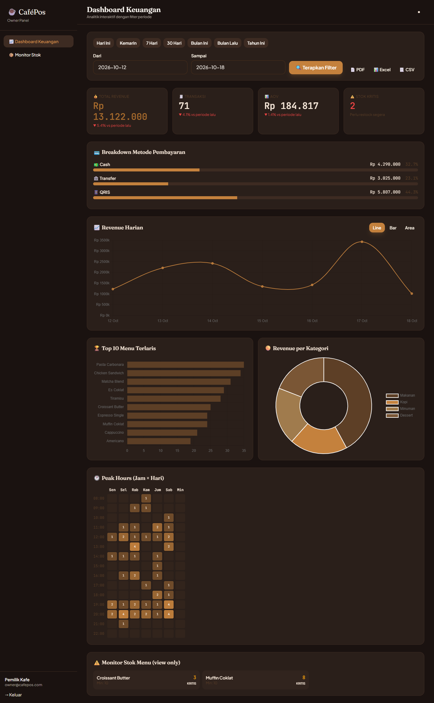

## Latar Belakang

Di banyak kafe kecil, pesanan masih dicatat manual di kertas lalu diteruskan ke dapur. Kasir sering bolak-balik ke meja, pesanan bisa salah tulis, dan pemilik baru tahu omzet harian setelah tutup toko. Proyek ini saya buat untuk memangkas alur itu: pelanggan memesan langsung dari HP, semua pesanan tercatat di sistem, dan laporan bisa dilihat kapan saja.

## Fitur

Aplikasi punya empat jenis pengguna. Pelanggan tidak perlu login.

**Pelanggan**
- Scan QR di meja, langsung masuk ke halaman menu meja tersebut
- Cari menu, filter per kategori, dan tambah catatan untuk pesanan (misal: gula sedikit)
- Pilih metode bayar: cash, transfer bank, atau QRIS
- Halaman lacak pesanan yang update otomatis (polling tiap beberapa detik)
- Tombol "sudah bayar" untuk QRIS supaya kasir dapat notifikasi

**Kasir**
- Daftar pesanan masuk dibagi tiga tab: Menunggu, Aktif, Selesai
- Notifikasi pesanan baru muncul otomatis tanpa reload manual (cek tiap 5 detik)
- Konfirmasi pembayaran, ubah status (diproses → siap → selesai), atau batalkan dengan alasan
- Stok otomatis berkurang saat pembayaran dikonfirmasi

**Admin**
- CRUD menu lengkap dengan upload foto (maks. 5 foto) dan label (Baru, Favorit, Pedas)
- CRUD kategori
- Manajemen meja: generate QR code per meja, download PNG, atau print langsung
- Kelola stok: restock/koreksi manual, ada riwayat perubahan stok
- Menu otomatis nonaktif kalau stok habis, dan ada peringatan kalau stok di bawah batas minimum
- Atur metode pembayaran yang aktif, upload gambar QRIS, kelola rekening bank
- Manajemen akun pengguna (admin, kasir, owner)

**Owner**
- Dashboard keuangan dengan filter periode (hari ini, 7 hari, 30 hari, bulan ini, dll.)
- Ringkasan total revenue, jumlah transaksi, rata-rata nilai order, beserta perbandingan dengan periode sebelumnya
- Grafik revenue harian (line/bar/area), 10 menu terlaris, revenue per kategori
- Heatmap jam ramai per hari
- Export laporan ke PDF, Excel, dan CSV
- Monitor stok (hanya lihat)

## Alur Pesanan

```
Pelanggan scan QR → pilih menu → checkout
        │
        ▼
  [Menunggu Konfirmasi] ──(kasir batalkan)──► [Dibatalkan]
        │
   kasir konfirmasi bayar, stok dipotong
        ▼
    [Diproses] → [Siap] → [Selesai]
```

Stok baru dipotong setelah kasir konfirmasi pembayaran, bukan saat pelanggan checkout. Jadi pesanan yang batal tidak mengacaukan jumlah stok. Proses potong stok dan pencatatan riwayatnya dijalankan dalam satu transaksi database, jadi kalau salah satu gagal, semuanya dibatalkan.

## Tampilan

### Pelanggan (mobile)

| Menu | Lacak Pesanan |
|---|---|
| 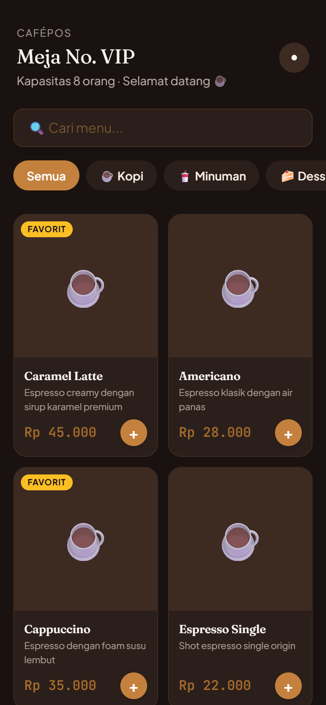 | 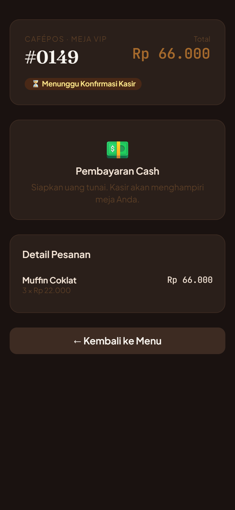 |

### Login & Kasir

| Login | Dashboard Kasir |
|---|---|
| 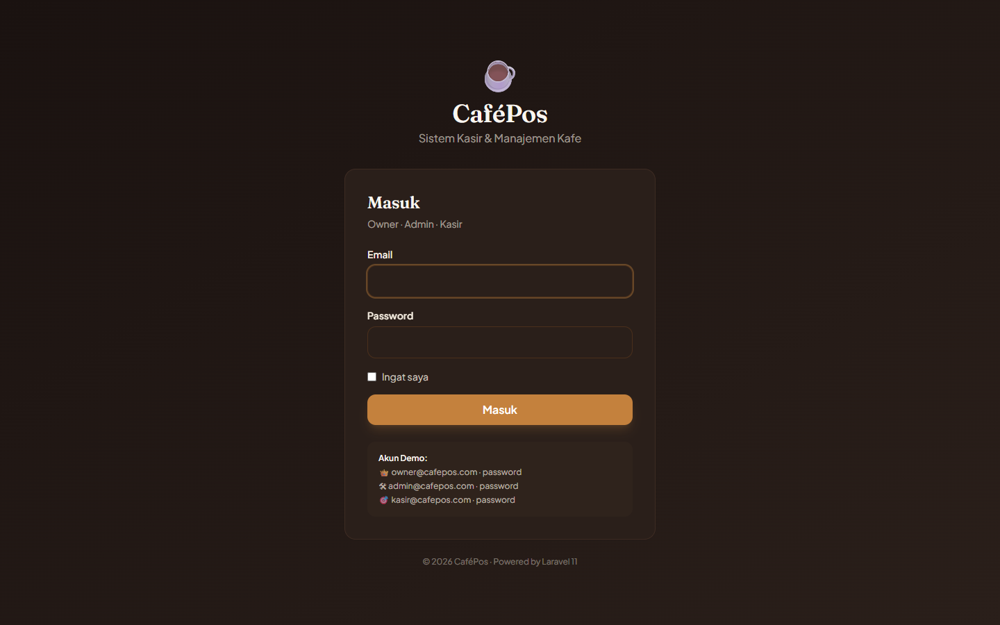 | 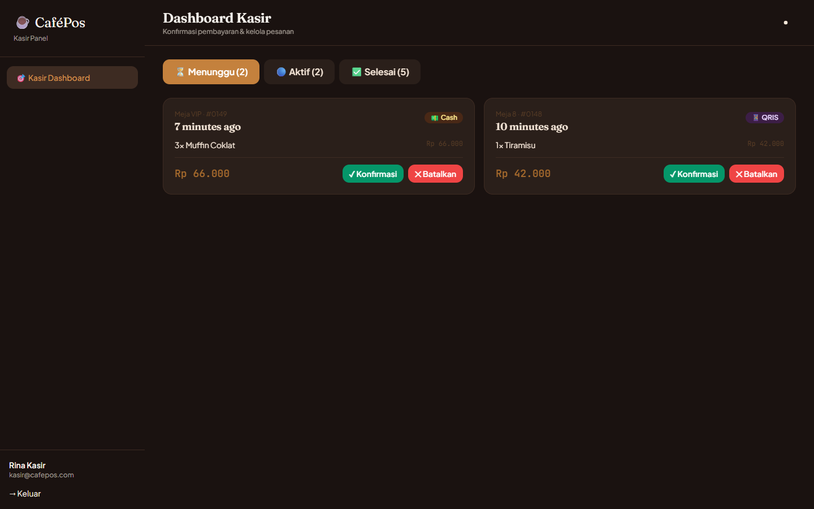 |

### Admin

| Dashboard | Kelola Menu |
|---|---|
| 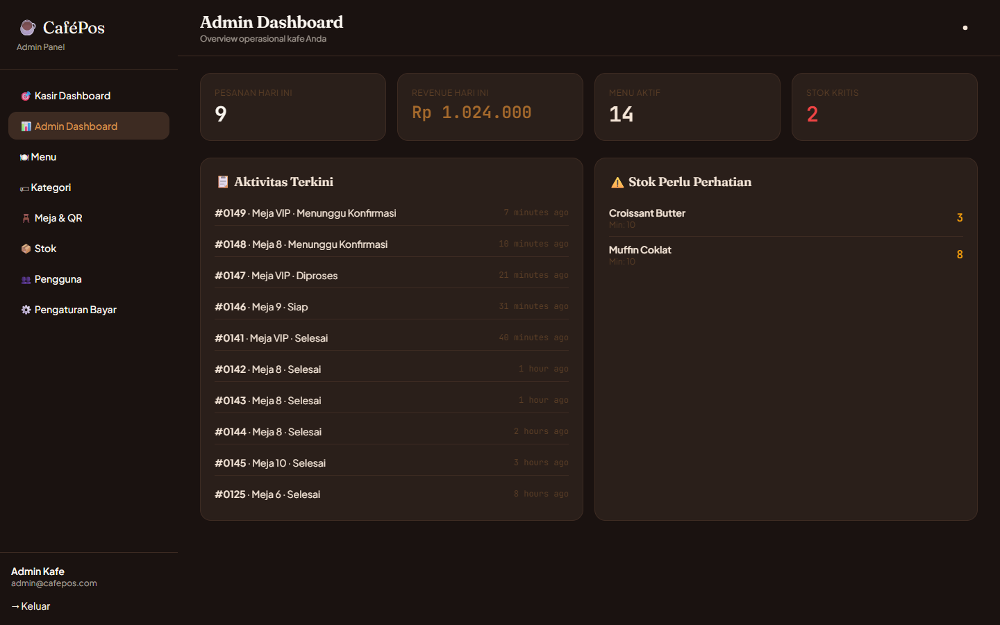 | 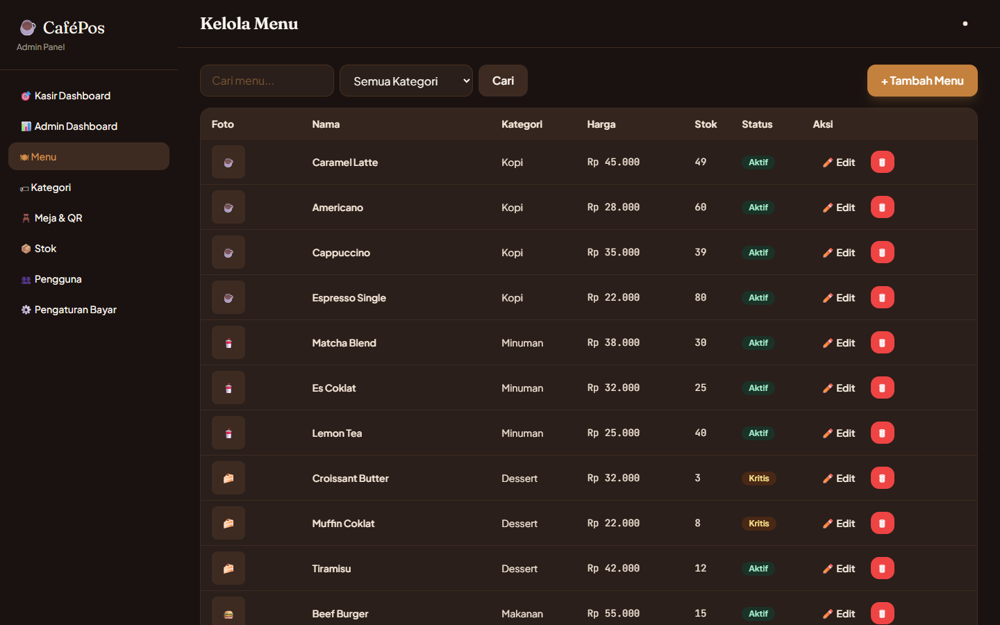 |

| Tambah Menu | Meja & QR Code |
|---|---|
| 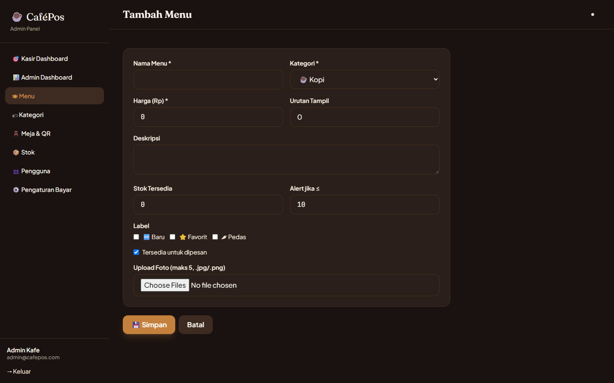 | 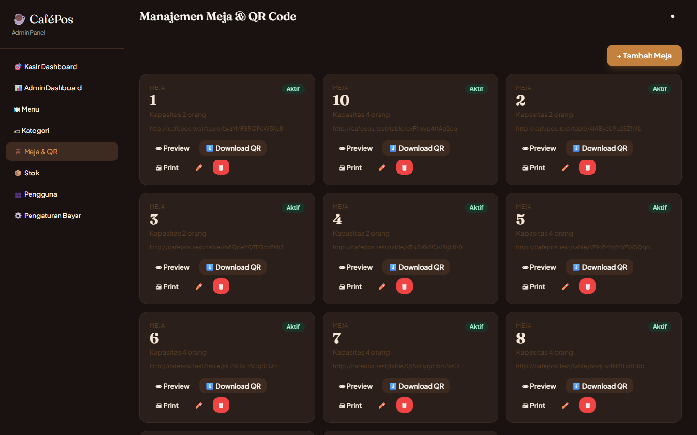 |

| Kelola Stok | Pengaturan Pembayaran |
|---|---|
| 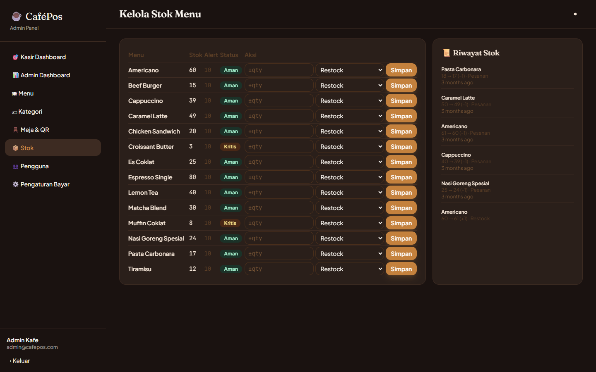 | 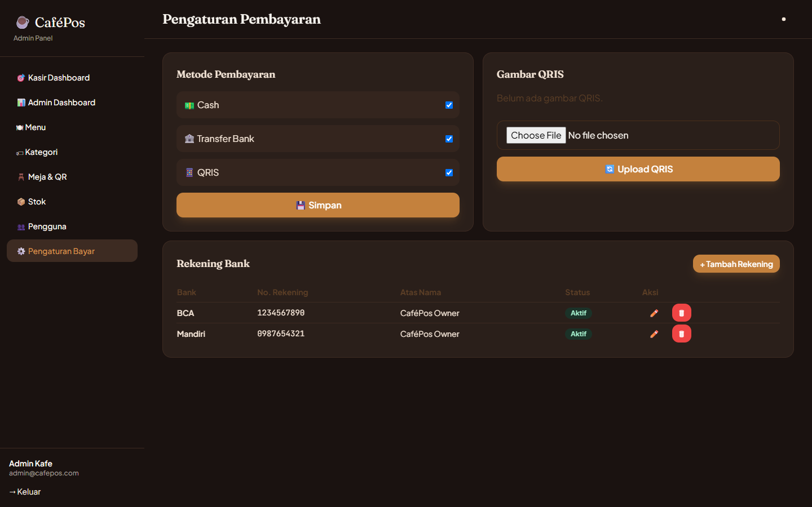 |

| Pengguna |
|---|
| 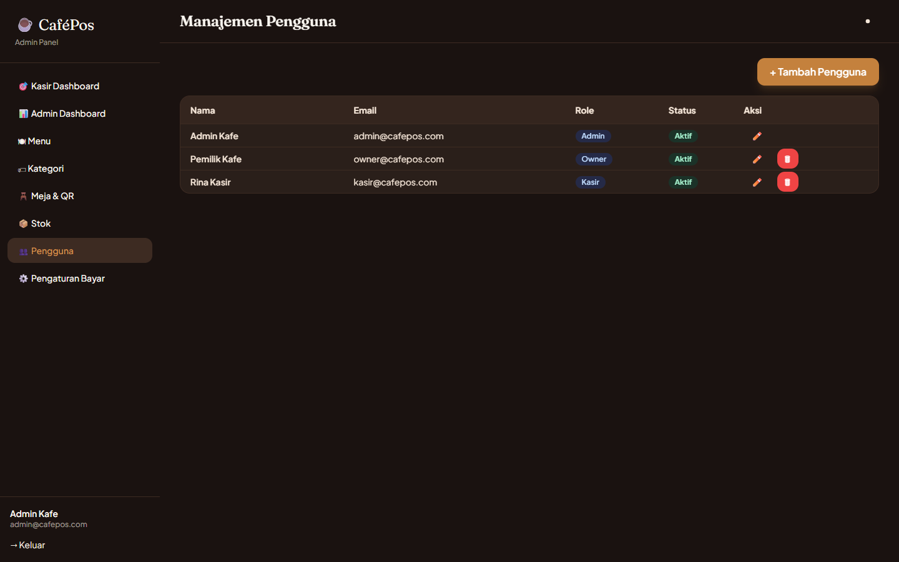 |

### Owner

| Dashboard Keuangan | Monitor Stok |
|---|---|
|  | 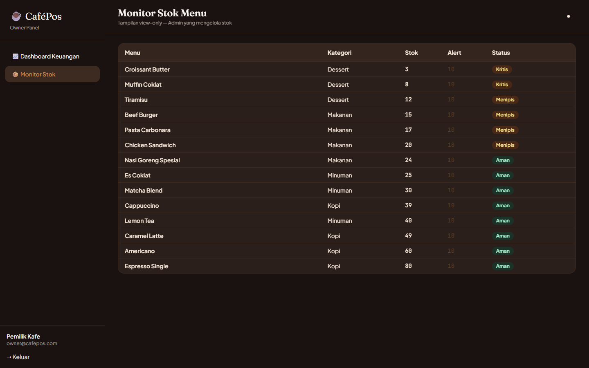 |

## Teknologi

| Bagian | Yang dipakai |
|---|---|
| Backend | Laravel 11, PHP 8.2 |
| Database | MySQL 8 |
| Frontend | Blade, Tailwind CSS 3, Alpine.js, Vite |
| Grafik | Chart.js 4 |
| Date picker | Flatpickr |
| QR Code | simplesoftwareio/simple-qrcode |
| Export PDF | barryvdh/laravel-dompdf |
| Export Excel | maatwebsite/excel |
| Olah gambar | intervention/image |

## Instalasi

Kebutuhan: PHP 8.2+, Composer, Node.js 18+, MySQL. Saya pakai Laragon di Windows, tapi XAMPP atau setup lain juga bisa.

```bash
git clone https://github.com/<username>/cafepos.git
cd cafepos

composer install
npm install

cp .env.example .env
php artisan key:generate
```

Buat database bernama `cafepos`, lalu sesuaikan bagian ini di `.env`:

```env
DB_DATABASE=cafepos
DB_USERNAME=root
DB_PASSWORD=
```

Jalankan migrasi, seeder, dan link storage (untuk foto menu dan gambar QRIS):

```bash
php artisan migrate --seed
php artisan storage:link
```

Build asset lalu jalankan:

```bash
npm run build
php artisan serve
```

Buka `http://127.0.0.1:8000`. Kalau mau ngoding sambil hot reload, jalankan `npm run dev` di terminal terpisah.

> Kalau pakai `php artisan serve`, ubah `APP_URL` di `.env` jadi `http://127.0.0.1:8000` supaya link QR meja mengarah ke alamat yang benar.

## Akun Demo

Semua password: `password`

| Role | Email |
|---|---|
| Owner | owner@cafepos.com |
| Admin | admin@cafepos.com |
| Kasir | kasir@cafepos.com |

Seeder juga mengisi 4 kategori, 14 menu, 11 meja (meja 1 sampai 10 dan VIP), 2 rekening bank, dan pengaturan pembayaran default.

Untuk mencoba sisi pelanggan, login sebagai admin, buka **Meja & QR**, lalu klik **Preview** di salah satu meja. Atau scan QR-nya dari HP kalau HP dan laptop ada di jaringan yang sama.

## Struktur Folder

```
app/
├── Http/Controllers/
│   ├── Admin/           # menu, kategori, meja, stok, user, pengaturan
│   ├── Owner/           # dashboard keuangan, stok, export laporan
│   ├── CustomerController.php
│   ├── KasirController.php
│   └── PaymentController.php
├── Http/Middleware/
│   └── RoleMiddleware.php   # batasi akses per role
└── Models/
database/
├── migrations/
└── seeders/
resources/views/
├── admin/
├── customer/
├── kasir/
├── owner/
└── layouts/
routes/web.php
```

## Rencana Pengembangan

- Notifikasi real-time pakai WebSocket (sekarang masih polling)
- Cetak struk ke printer thermal
- Tampilan khusus dapur (kitchen display)
- Integrasi payment gateway agar QRIS terverifikasi otomatis

## Lisensi

MIT
